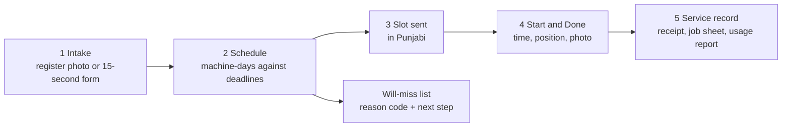
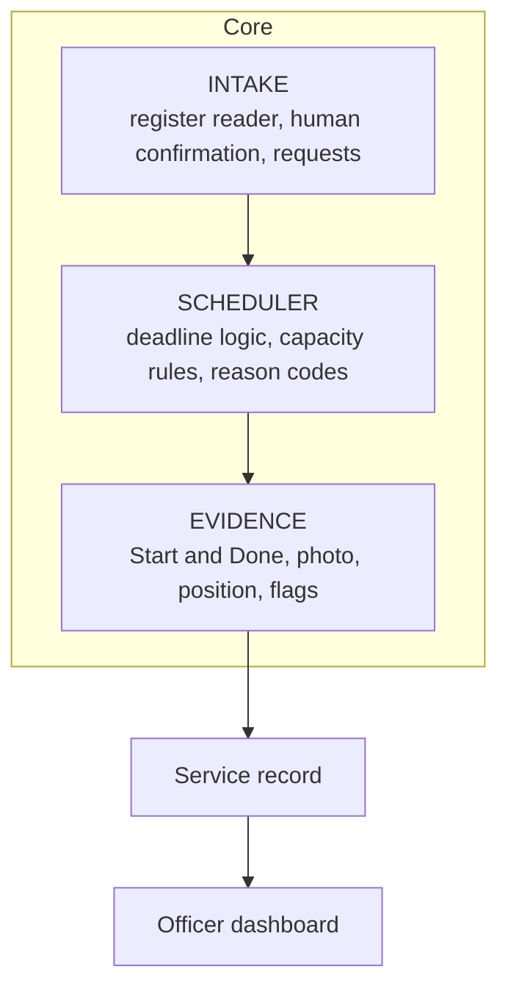

[](https://github.com/kambojmayan-png/Vaari/actions/workflows/ci.yml)


# Vaari (ਵਾਰੀ): every field gets its turn

**Vaari reduces coordination friction between crop-residue machinery and farmers during the narrow harvest-to-sowing window.** It reads the paper register a hiring-centre operator already keeps, schedules each request against its sowing deadline, shows which requests will miss and why, and closes every job with evidence from the phone already in the field.

> **Status: v0.1.0, working MVP.** All three build phases are complete and tagged: the backend core, the four screens (Desk, Driver, Record, Officer), and register intake, geodesic evidence checks and fallback hardening. Everything runs offline on fictional seeded data. See [what is real and what is simulated](#what-is-real-and-what-is-simulated) before judging it.

[Quick start](#quick-start) · [Demo](#the-demo-in-eight-steps) · [Screens](#screens) · [Architecture](#architecture) · [Configuration](#configuration) · [Testing](#testing) · [Deploying](#deploying) · [Limitations](#known-limitations) · [Docs](#documentation)

---

## Quick start

You need **Python 3.12** and **Node 22**. Windows, macOS and Linux all use the same commands. (`make X` also works and simply calls `python tasks.py X`.)

```bash
git clone https://github.com/kambojmayan-png/Vaari.git
cd Vaari

python tasks.py setup    # .venv, Python deps, web deps, Playwright browser, web build
cp .env.example .env     # on Windows: copy .env.example .env
python tasks.py reset    # wipe and reseed the demo (takes about a second)
python tasks.py serve    # API and web app together on http://localhost:8000
```

Open `http://localhost:8000` and enter the passcode from `.env`. After `reset` you should see **40 requests: 28 scheduled, 7 will miss, 5 need info**. The terminal also prints a driver link for each of the three machines.

> The default passcode is `change-me`. Set a long random `VAARI_DEMO_PASSCODE` in `.env` before anyone else can reach the app.

| Command | What it does |
| --- | --- |
| `python tasks.py setup` | One-time install of everything |
| `python tasks.py reset` | Rebuild the database, seed it and run the scheduler |
| `python tasks.py seed` | Seed without wiping first |
| `python tasks.py dev` | Vite dev server (`:5173`) plus API with reload (`:8000`) |
| `python tasks.py serve` | Build the web app and serve everything on `:8000` |
| `python tasks.py tunnel` | Free HTTPS tunnel so a phone can share its position (refuses a weak passcode) |
| `python tasks.py test` | Backend test suite |
| `python tasks.py smoke` | Fast end-to-end API check |
| `python tasks.py e2e` | Browser end-to-end tests (Playwright) on a temporary database |
| `python tasks.py reader-eval` | Score the register reader on `examples/register_pages/` |
| `python tasks.py purge-images` | Delete register images past the retention period (`--dry-run` to preview) |
| `python tasks.py screenshots` | Recapture the README screenshots from seeded data |

**Using a phone as the driver:** browsers only share position over HTTPS, so run `python tasks.py tunnel` and open the driver link it prints. The full walkthrough, including venue-Wi-Fi fallbacks, is in [docs/DEMO_SETUP.md](docs/DEMO_SETUP.md).

---

## The demo in eight steps

1. Upload a photo of a sample register page.
2. Vaari drafts structured requests and highlights the fields it is unsure of.
3. The operator confirms or corrects each row. Nothing is saved unconfirmed.
4. The scheduler assigns machines against sowing deadlines.
5. The dashboard shows the requests that will miss, each with a reason code and a next step.
6. The operator opens a prefilled Punjabi WhatsApp message for the farmer.
7. The driver opens the slot and submits Start and Done evidence: time, position, photo.
8. Vaari generates the service record and the officer dashboard updates.

## Screens

| Operator Desk (`/desk`) | Register Intake (`/intake`) |
| :---: | :---: |
|  |  |

| Driver (`/driver/:token`) | Service Record (`/record/:token`) |
| :---: | :---: |
|  |  |

| Officer Dashboard (`/officer`) |
| :---: |
|  |

*All screenshots use fictional seeded data.*

| Screen | It answers |
| --- | --- |
| **Desk** | How many requests are scheduled, will miss, or need info (no harvest date yet)? Click one for farmer, plot, acres, machine type, deadline, slot and reason |
| **Intake** | What did the register say? Photo on one side, an editable table on the other, with uncertain cells highlighted |
| **Driver** | Today's jobs in order. Start, take a photo, mark done. Shows which evidence was captured: position, photo, timestamp |
| **Officer** | Total, scheduled, completed, will miss, needs review, capacity use. Filter by date, machine, village and status. Lists flagged jobs without names or phone numbers |
| **Record** | The whole story of one job: request, assignment, start evidence, completion evidence, outcome. It doubles as the farmer's receipt, and its SHA-256 hash can be re-verified in the page |

---

## The problem, in three sourced numbers

| Number | What it says | Source |
| --- | --- | --- |
| 1,37,407 | Subsidised crop-residue machines in Punjab, across 25,417 custom hiring centres | [CEEW, Sept 2025](https://www.ceew.in/publications/improving-access-to-crop-residue-management-solutions-with-custom-hiring-centres-in-agriculture) |
| 15% | Share of in-situ farmers who reach a machine through a hiring centre, in a CEEW survey. Bookings run on phone calls and first-come lists; about 1% of farmers use the booking apps | Same report |
| About 20 days | The usual window between harvesting paddy and sowing wheat. It varies by variety and district | Commonly cited; to be recorded per village in the pilot |

**Hypothesis, not yet a finding:** some unserved machinery requests are avoidable through better scheduling, communication and field-level coordination. The [validation plan](docs/ROADMAP.md#validation-before-code) tests this on real behaviour.

## How it works



- **It reads the register instead of replacing it.** The operator's new habit is one photo an evening and a quick check of the rows it drafts.
- **AI output is a draft, never a request.** A vision model proposes and a person confirms. Remove the model and the 15-second form does the same job.
- **The scheduler is deterministic and explains itself.** Every unserved request carries a machine-readable reason code, a sentence, and a suggested action.
- **Evidence is a plausibility signal, not proof.** Position is self-reported by a phone. Vaari records it, checks it against the plot, and never lets a flag penalise anyone.

---

## What is real and what is simulated

Every component is labelled by its honest status in v0.1.

| Component | Status | What is real vs. simulated |
| --- | --- | --- |
| **Deadline-first scheduler** (`app/scheduler/`) | Production-grade core | Pure, deterministic scheduler using integer hundredths of an acre, inclusive deadlines, nearest-neighbour daily sequencing and structured reason codes |
| **Slot state machine and record hash** (`app/evidence/`) | Production-grade core | Enforced transitions (`scheduled → in_progress → done`), magic-byte photo validation, canonical JSON SHA-256 tamper check |
| **Geodesic and position checks** (`area.py`, `position.py`) | Production-grade core | WGS84 geodesic acreage (`pyproj.Geod`); UTM Zone 43N point-to-polygon distance with a `max(30 m, accuracy)` tolerance |
| **Evidence flags** (`rules.py`, `checks.py`) | Real, non-punitive | `too_fast`, `duplicate_photo`, position and acreage flags. A flag asks a person to look; it never blocks a job |
| **Register reader** (`app/intake/`) | Mock by default, hosted optional | Tests and offline demos use the mock reader (badged `reader: mock`). The hosted reader (Gemini or Anthropic) is off unless `VAARI_ALLOW_HOSTED_READER=true`, and is meant for synthetic pages only |
| **Farmer consent** | Simulated | Ticked by the operator during intake. Every screen and record carries the `consent simulated` badge |
| **Device position** | Self-reported by the phone | From the browser Geolocation API. If it is denied, the job still closes with a `position self-reported` badge |
| **WhatsApp message** (`app/messaging/`) | Shortcut | Bilingual Punjabi/English text on screen plus a prefilled `wa.me` link. No paid messaging API |
| **Access control** (`app/auth.py`) | Demo only | Shared passcode for operator and officer routes; unguessable 128-bit link tokens for driver and record URLs |
| **Demo data** (`app/seed/`) | Fictional | 40 requests generated relative to today's date, each badged `seeded request` |
| **Tier 2 extras** | Built | Usage CSV export, an offline-safe map panel, and rescue options (nearest compatible centres) on will-miss requests |
| **Satellite sensing, GPX coverage trace** | Not built | Cut to keep the demo fully deterministic. `/api/health` reports `satellite: "disabled"` |

### What the demo proves, and what it does not

| The demo proves that Vaari can | The demo does **not** prove |
| --- | --- |
| turn a paper register into structured requests, with a human confirming every row | any reduction in stubble burning |
| schedule requests against machine capacity and deadlines, deterministically | satellite harvest accuracy on Punjab paddy |
| identify requests that cannot meet their deadline, and say why | fraud prevention: a phone's position can be spoofed |
| communicate a committed slot | production scalability |
| capture field evidence and generate a service record | that operators will adopt it |
| keep working when the AI model, the tunnel or the satellite source fails, and say so on screen | that coordination, not price or shortage, is the binding constraint |

---

## Architecture

One Python process, one SQLite file, one static frontend.



Every unreliable dependency sits behind an interface with a mock, so each part can be built and tested alone:

| Interface | Built in v0.1 | Planned | Fallback when it fails |
| --- | --- | --- | --- |
| `RegisterReader` | Mock, hosted vision model | Local OCR, Ollama | The manual form, with the photo beside it |
| Scheduler | Greedy deadline-first | Routing solver | The greedy scheduler is the default |
| Notifier | On-screen panel, `wa.me` link | WhatsApp Business | The on-screen panel always renders |
| Position check | shapely + pyproj geometry | | The job closes, badged "position self-reported" |
| Harvest sensor | Disabled | Sentinel-2 reader | Not needed by the core loop |

### Fallback behaviour

Every fallback shows a visible status. The app never pretends the primary dependency succeeded. Results of killing each dependency in turn are recorded in [docs/FALLBACK_RESULTS.md](docs/FALLBACK_RESULTS.md).

| Dependency | Fallback | What the screen says |
| --- | --- | --- |
| Vision model | Manual form with the photo beside it | "Reader unavailable: type the rows" |
| WhatsApp | `wa.me` link, then the on-screen message | "Not sent: copy or call" |
| Phone position denied or no HTTPS | Start and Done still close | Badge: "position self-reported" |
| Database deleted | `python tasks.py reset` rebuilds it in under a minute | Status strip shows the state |

### Tech stack

| Layer | Choice | Why |
| --- | --- | --- |
| API | FastAPI + Pydantic | Validation and OpenAPI docs for free; same language as the geometry libraries |
| Data | SQLite (WAL) via SQLAlchemy | Cannot go offline during a demo. Postgres later is a connection string |
| Geometry | shapely + pyproj | Point-in-plot and acres with no spatial database |
| Frontend | React 18, Vite, React Router, TypeScript | Boring and known |
| Tests | pytest, Playwright | Boundary tests on the scheduler first |

### Repository layout

```
Vaari/
  app/
    routes/        requests, machines, plots, intake, schedule, slots, records, dashboard, driver, health
    scheduler/     plan.py, reasons.py, distance.py, dates.py, service.py
    intake/        reader.py, hosted.py, prompt.py, validate.py, eval.py
    evidence/      lifecycle.py, position.py, area.py, rules.py, checks.py, photos.py, record.py
    messaging/     render.py, templates.json
    seed/          seed.py, villages.json
  web/
    src/pages/       Desk, Driver, Intake, Officer, Record
    src/components/  status strip, badges, forms, panels
    e2e/             Playwright specs
  tests/           unit and api
  examples/        demo plot, register-page evaluation files
  docs/            contract, API, architecture, privacy, setup, readiness, screenshots
```

## API overview

Groups: `/api/requests`, `/api/machines`, `/api/plots`, `/api/intake`, `/api/schedule`, `/api/slots`, `/api/records`, `/api/dashboard`, `/api/health`. Errors are structured, so the frontend never parses prose:

```json
{ "error_code": "INVALID_TRANSITION", "message": "A slot must be started before it can be marked done.", "details": {} }
```

Reference with examples: [docs/API.md](docs/API.md). The machine-readable schema is committed as [docs/openapi.json](docs/openapi.json) and a test fails if it drifts from the code. With the server running, interactive docs are at `/docs`.

---

## Configuration

Copy `.env.example` to `.env`. The settings you are most likely to change:

| Variable | Default | Purpose |
| --- | --- | --- |
| `VAARI_DEMO_PASSCODE` | `change-me` | Shared passcode for operator and officer screens. **Change it** |
| `VAARI_READER` | `mock` | `mock` or `hosted` |
| `VAARI_ALLOW_HOSTED_READER` | `false` | Must be `true` before any image is sent to a hosted model |
| `VAARI_VISION_PROVIDER` | `gemini` | `gemini` or `anthropic` |
| `GEMINI_API_KEY` / `ANTHROPIC_API_KEY` | empty | Only needed for the hosted reader. Never commit them |
| `VAARI_TODAY` | empty | Pin the demo date, for repeatable rehearsals |
| `VAARI_PUBLIC_BASE_URL` | empty | Base URL used in driver and record links |
| `VAARI_DB_PATH` / `VAARI_DATA_DIR` | `data/...` | Where the SQLite file and photos live |
| `VAARI_TOO_FAST_MIN_PER_ACRE` | `25` | Threshold for the `too_fast` evidence flag |

## Testing

```bash
python tasks.py test     # backend: scheduler boundaries, evidence rules, intake, API, fallbacks
python tasks.py smoke    # one fast end-to-end API pass
python tasks.py e2e      # browser: Desk, Driver, Record, Officer, Intake and fallbacks, offline
```

CI runs the backend tests and the web build on every push. Small samples are reported as counts, never percentages.

| What | Measure |
| --- | --- |
| Scheduler | Boundary tests on deadlines and capacity; determinism; a reason code for every unserved request |
| Register reader | Rows usable without edits; wrong fields by type; seconds per page. Test pages carry no real personal data. See [examples/register_pages/](examples/register_pages/) |
| Evidence | Jobs closed with both photos and a plausible position; invalid transitions rejected |
| Fallbacks | Each dependency killed in turn; the loop still closes and the screen says what happened |

The readiness checklist and its results are in [docs/READINESS.md](docs/READINESS.md).

## Deploying

Vaari writes a SQLite database and evidence photos to disk, so it needs a host with a **persistent disk or volume**. Serverless platforms such as Vercel give functions only temporary, per-instance storage, so run the backend on a host with a disk (Render, Railway or Fly.io, for example) and, if you like, put only the static frontend on Vercel with a rewrite that forwards `/api/*` to the backend.

The simplest option is one service: build with `pip install -r requirements.txt && cd web && npm ci && npm run build`, start with `uvicorn app.main:app --host 0.0.0.0 --port $PORT`, and mount a disk for `VAARI_DB_PATH` and `VAARI_DATA_DIR`. Use a strong passcode, keep the hosted reader off for real data, and run `python tasks.py reset` once to seed.

---

## Known limitations

- Position is reported by the phone, including its accuracy. It can be spoofed. It is supporting evidence, not proof of presence.
- SHA-256 gives **exact duplicate detection** only. A resized, cropped or re-encoded photo passes. Perceptual hashing is on the roadmap.
- The demo passcode is not security. Authentication, roles, rate limits and upload scanning must arrive before any pilot.
- Handwritten Gurmukhi is hard for vision models. The name field is optional because the phone number is the key.
- The register reader was evaluated against the mock reader in the repository. Run `python tasks.py reader-eval` with your own synthetic pages to measure the hosted reader.
- Harvest sensing from satellite imagery is not built and not validated on Punjab paddy.
- Vaari does not change the economics: not burning costs a farmer roughly Rs. 2,000 an acre.

## Responsible use

- **Not an enforcement tool.** No adverse action may follow from a Vaari record. "Will miss" means a request cannot be served before its deadline with the machines available. It is never a claim that a farmer will burn.
- **Consent-gated by design, simulated in the prototype.** Three separate consents: to be served, to have the job evidenced, to share the record.
- **Data minimisation and retention.** No Aadhaar, no land records. Register images are deleted after confirmation and a short retention period (`python tasks.py purge-images`). Records never contain a farmer's name or phone number. See [docs/PRIVACY.md](docs/PRIVACY.md).
- **Synthetic data only** in the repository, the screenshots and the reader evaluation.

## Roadmap

`v0.1` MVP (this release) → `v0.2` pilot hardening → `v0.3` offline and mobile → `v0.4` scheduling optimisation → `v0.5` messaging → `v0.6` security and privacy → `v0.7` satellite intelligence → `v1.0` pilot production. Details: [docs/ROADMAP.md](docs/ROADMAP.md).

## Engineering highlights

- **Workflow first, intelligence second, optimisation third, hardening last.** A small system that works end to end beats a large one with half-built modules.
- **Interfaces with mocks around every unreliable dependency**, so the vertical slice was built on fakes and no engine blocked another.
- **Date semantics fixed before code:** `deadline_date` is the last acceptable service date, inclusive, with boundary tests written first.
- **Two state machines enforced by the backend**, for requests and for slots. "Done before Start" is rejected with a structured error.
- **A contract-first build:** one [CONTRACT.md](docs/CONTRACT.md) fixed names, schemas and error codes before code, and later phases changed it only additively.
- **About thirty open projects surveyed;** every borrowed idea is credited in [docs/PRIOR_ART.md](docs/PRIOR_ART.md).

## Documentation

[Build contract](docs/CONTRACT.md) · [Phases](docs/PHASES.md) · [Architecture](docs/ARCHITECTURE.md) · [API](docs/API.md) · [Build plan](docs/BUILD_PLAN.md) · [Testing](docs/TESTING.md) · [Demo setup](docs/DEMO_SETUP.md) · [Readiness](docs/READINESS.md) · [Fallback results](docs/FALLBACK_RESULTS.md) · [Privacy](docs/PRIVACY.md) · [Prior art](docs/PRIOR_ART.md) · [Roadmap](docs/ROADMAP.md) · [Decisions](docs/DECISIONS.md) · [Handoff notes](HANDOFF.md) · [Changelog](CHANGELOG.md)

## Contributing and licence

See [CONTRIBUTING.md](CONTRIBUTING.md) and [SECURITY.md](SECURITY.md). Code is released under the [MIT License](LICENSE).

## Authors

Arnav Chaudhary · Garvit Agarwal · Mayan Kamboj

Built for Zinnovatio 4.0, Chandigarh University, Track 2: AgriTech & Rural Transformation. Primary SDG target: 2.4.
