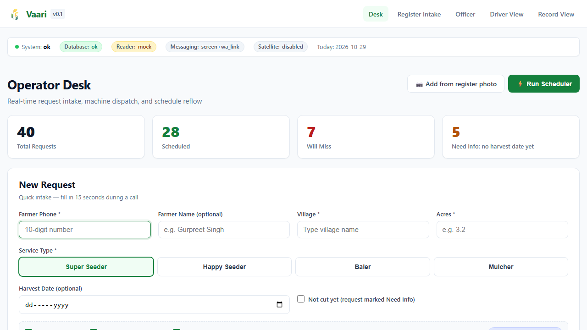
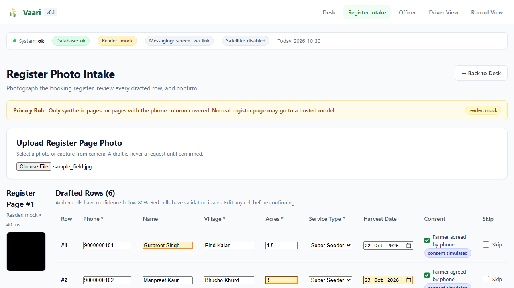
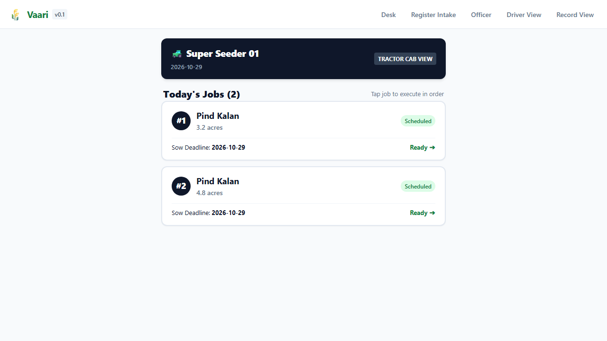
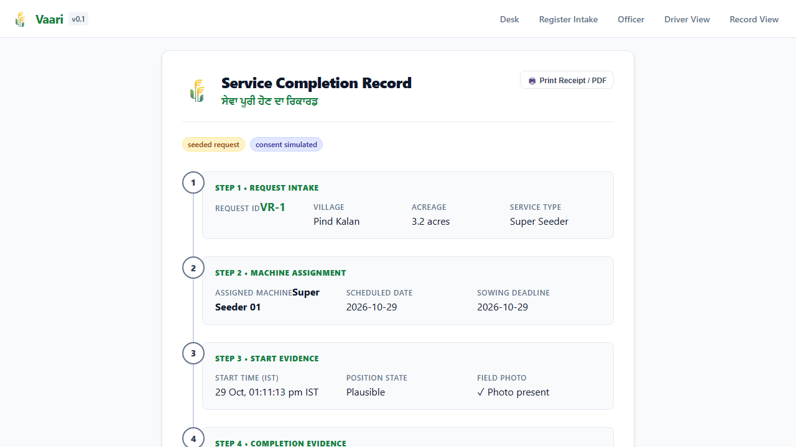
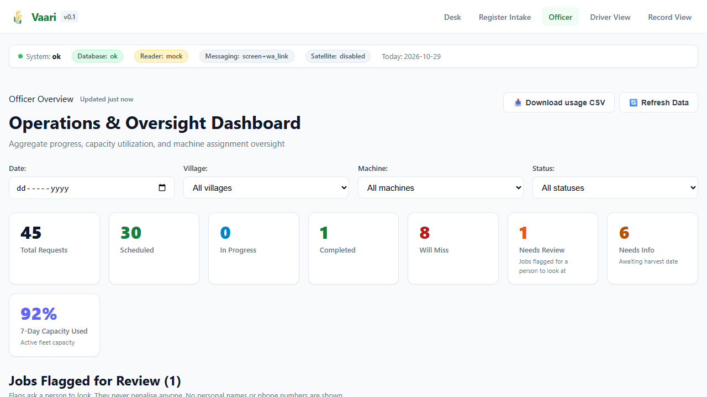
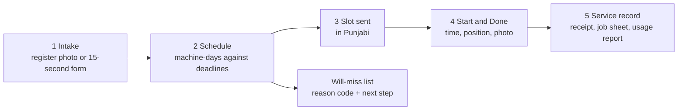
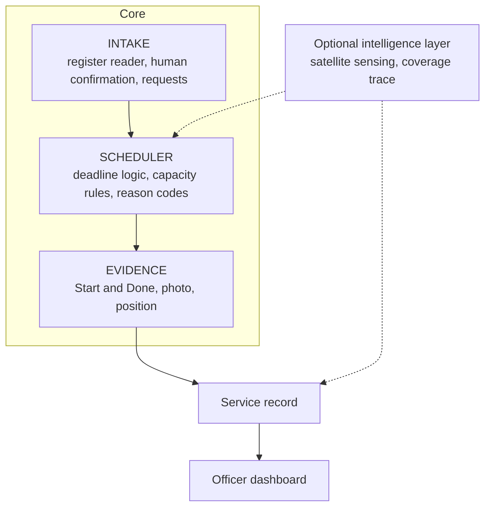

[](https://github.com/kambojmayan-png/Vaari/actions/workflows/ci.yml)

# Vaari (ਵਾਰੀ) — every field gets its turn

**Vaari reduces coordination friction between crop-residue machinery and farmers during the narrow harvest-to-sowing window.** It reads the paper register a hiring-centre operator already keeps, schedules each request against its sowing deadline, shows which requests will miss and why, and closes every job with evidence from the phone already in the field.

> **Status: v0.1 MVP built and verified (26 Oct 2026).** Phases 1 (backend core), 2 (operator, driver, officer, and record screens), and 3 (register reader, geodesic polygon checks, non-punitive evidence flags, fallback hardening, full Playwright E2E, and Tier 2 enhancements) are complete and tagged `v0.1.0`. Run `python tasks.py setup && python tasks.py reset && python tasks.py test && python tasks.py e2e` to verify the entire stack offline.

[Build contract](docs/CONTRACT.md) · [Phases](docs/PHASES.md) · [Architecture](docs/ARCHITECTURE.md) · [API](docs/API.md) · [Build plan](docs/BUILD_PLAN.md) · [Testing](docs/TESTING.md) · [Privacy](docs/PRIVACY.md) · [Prior art](docs/PRIOR_ART.md) · [Roadmap](docs/ROADMAP.md) · [Decisions](docs/DECISIONS.md)

---

## 30-second demo

1. Upload a photo of a sample register page.
2. Vaari drafts structured requests and highlights the fields it is unsure of.
3. The operator confirms or corrects each row. Nothing is saved unconfirmed.
4. The scheduler assigns machines against sowing deadlines.
5. The dashboard shows the requests that will miss, each with a reason code and a next step.
6. The operator opens a prefilled Punjabi WhatsApp message for the farmer.
7. The driver opens the slot and submits Start and Done evidence: time, position, photo.
8. Vaari generates the service record and the officer dashboard updates.

### Demo screens (fictional seeded data)

| Operator Desk (`/desk`) | Register Intake (`/intake`) |
| :---: | :---: |
|  |  |

| Driver Execution (`/driver/:token`) | Service Audit Record (`/record/:token`) |
| :---: | :---: |
|  |  |

| Officer Monitoring Dashboard (`/officer`) |
| :---: |
|  |

## What the demo proves, and what it does not

| The demo proves that Vaari can | The demo does **not** prove |
| --- | --- |
| turn a paper register into structured requests, with a human confirming every row | any reduction in stubble burning |
| schedule requests against machine capacity and deadlines, deterministically | satellite harvest accuracy on Punjab paddy |
| identify requests that cannot meet their deadline, and say why | fraud prevention: a phone's position can be spoofed |
| communicate a committed slot | production scalability |
| capture field evidence and generate a service record | that operators will adopt it |
| keep working when the AI model, the tunnel or the satellite source fails, and say so on screen | that coordination, not price or shortage, is the binding constraint |

## Reality ledger (v0.1)

Every component in Vaari v0.1 is labelled honestly by its implementation status:

| Component | Status in v0.1 | What is real vs. simulated |
| --- | --- | --- |
| **Deadline-first scheduler (`app/scheduler/plan.py`)** | **Production-grade core** | Pure, deterministic integer-hundredths (`acres_x100`) scheduler with inclusive deadlines, nearest-neighbour daily sequencing, and structured reason codes |
| **Slot state machine & SHA-256 record hash (`app/evidence/`)** | **Production-grade core** | Enforced transitions (`scheduled -> in_progress -> done`), magic-bytes photo validation, and canonical JSON (`v1`) SHA-256 tamper verification |
| **Geodesic polygon & position checks (`area.py`, `position.py`)** | **Production-grade core** | WGS84 geodesic acreage (`pyproj.Geod`) and UTM Zone 43N (`EPSG:32643`) point-to-polygon distance with `max(30m, accuracy_m)` tolerance |
| **Register reader (`app/intake/`)** | **Mock (default) + Hosted Vision** | Automated tests and offline demos use `MockRegisterReader` (badged `reader: mock`). `HostedVisionReader` (Gemini / Anthropic) is locked behind `VAARI_ALLOW_HOSTED_READER=true` and used **only on synthetic pages** |
| **Farmer consent (`farmer.consent_*`)** | **Simulated** | Ticked by the operator during intake; every screen and record carries the `consent simulated` badge |
| **Device GPS position (`evidence.lat/lon`)** | **Self-reported by phone** | Reported by the browser's Geolocation API; when unavailable or denied, jobs still close with the `position self-reported` badge |
| **WhatsApp notification (`app/messaging/`)** | **Shortcut (`wa.me` link + screen)** | Renders bilingual Punjabi/English text on screen and opens a prefilled `wa.me` click-to-chat link; no paid messaging API required |
| **Access control (`app/auth.py`)** | **Demo shortcut (DEMO ONLY)** | Shared passcode (`X-Vaari-Passcode`) for operator/officer routes and unguessable 128-bit link tokens for driver/record URLs |
| **Demo dataset (`app/seed/seed.py`)** | **Seeded fictional data** | 40 fictional requests generated relative to `clock.today()`; every seeded item carries the `seeded request` badge |
| **Satellite sensing (`app/optional/`)** | **Disabled in v0.1** | Core never imports `app/optional/`; `/api/health` reports `satellite: "disabled"` |

## The problem, in three sourced numbers

| Number | What it says | Source |
| --- | --- | --- |
| 1,37,407 | Subsidised crop-residue machines in Punjab, across 25,417 custom hiring centres | [CEEW, Sept 2025](https://www.ceew.in/publications/improving-access-to-crop-residue-management-solutions-with-custom-hiring-centres-in-agriculture) |
| 15% | Share of in-situ farmers who reach a machine through a hiring centre, in a CEEW survey. Bookings run on phone calls and first-come lists; about 1% of farmers use the booking apps | Same report |
| About 20 days | The usual window between harvesting paddy and sowing wheat. It varies by variety and district | Commonly cited; to be recorded per village in the pilot |

**Hypothesis, not yet a finding:** some unserved machinery requests are avoidable through better scheduling, communication and field-level coordination. The [validation plan](docs/ROADMAP.md#validation-before-code) tests this on real behaviour before any code is written.

## How it works



- **It reads the register instead of replacing it.** The operator's new habit is one photo an evening and a quick check of the rows it drafts.
- **The AI output is a draft, never a request.** A vision model proposes; a person confirms. Remove the model and the 15-second form does the same job.
- **The scheduler is deterministic and explains itself.** Every unserved request carries a machine-readable reason code, a sentence, and a suggested action.
- **Evidence is a plausibility signal, not proof.** Position is self-reported by a phone. Vaari records it, checks it against the plot, and never lets a record penalise anyone.
- **Satellite sensing is an optional intelligence layer.** The core loop needs no imagery.

## Build tiers

The repository describes a multi-month product. The first build is 24 hours, so scope is tiered and the kill order is fixed in advance. Details: **[docs/BUILD_PLAN.md](docs/BUILD_PLAN.md)**.

| Tier | Scope | Rule |
| --- | --- | --- |
| 0 — must work | FastAPI, SQLite, basic React, requests, machines, deterministic scheduler, will-miss with reason codes, slot lifecycle, service records | A complete loop by hour 8 |
| 1 — demo differentiators | Register photo → draft → confirmation, `wa.me` link, photo + position evidence with plausibility checks | Starts only when Tier 0 passes its tests |
| 2 — only if stable | Map panel, officer analytics, coverage trace, satellite module, review step | Never blocks the demo |
| 3 — do not touch in the first 12 hours | Routing solver, offline queue, HLS, Sentinel-1, learned models, production auth | Roadmap, not hackathon |

## Architecture at a glance



One Python process, one SQLite file, one static frontend. Every unreliable dependency sits behind an interface with a mock, so each part can be built and tested alone:

| Interface | Implementations | Fallback when it fails |
| --- | --- | --- |
| `RegisterReader.read(image) -> RegisterDraft` | Mock, hosted vision model, local OCR, Ollama | The manual form, with the photo beside it |
| `Scheduler.plan(requests, machines, today) -> Plan` | Greedy deadline-first; a routing solver later | The greedy scheduler is the fallback |
| `Notifier.notify(slot) -> Message` | On-screen panel, `wa.me` link, WhatsApp Business later | The on-screen panel always renders |
| `PositionChecker.check(fix, plot) -> Plausibility` | Geometry with shapely | The job closes, badged "position self-reported" |
| `HarvestSensor.sense(plot) -> HarvestInterval` | Mock, Sentinel-2 reader | Hand-exported image chips, labelled |

## Screens

| Screen | It answers |
| --- | --- |
| **Desk** | How many requests, scheduled, will miss, need info (no harvest date yet)? Click one: farmer, plot, acres, machine type, deadline, slot, reason |
| **Driver** | Today's jobs in order. Start, take photo, mark done. Evidence state: position, photo, timestamp |
| **Officer** | Total, scheduled, completed, will miss, needs review, capacity use. Filter by date, machine, village, status |
| **Record** | The whole story of one job: request → assignment → start evidence → completion evidence → outcome. It doubles as the farmer's receipt |

## API overview

Groups: `/api/requests`, `/api/machines`, `/api/plots`, `/api/intake`, `/api/schedule`, `/api/slots`, `/api/records`, `/api/dashboard`. Errors are structured, so the frontend never parses prose:

```json
{ "error_code": "INVALID_TRANSITION", "message": "A slot must be started before it can be marked done." }
```

Full reference with examples: **[docs/API.md](docs/API.md)**.

## Fallback behaviour

Every fallback shows a visible status. The app never pretends the primary dependency succeeded.

| Dependency | Fallback | What the screen says |
| --- | --- | --- |
| Vision model | Manual form with the photo beside it | "Reader unavailable: type the rows" |
| WhatsApp | `wa.me` link, then the on-screen message | "Not sent: copy or call" |
| HTTPS tunnel for the phone | Start and Done in the laptop's browser | Badge: "position self-reported" |
| Satellite source | Precomputed, hand-exported chips | Badge: "exported by hand" |
| Routing solver | Deterministic greedy scheduler | Nothing: it is the default |

## Tech stack

| Layer | Choice | Why |
| --- | --- | --- |
| API | FastAPI + Pydantic | Validation and OpenAPI docs for free; same language as the geometry libraries |
| Data | SQLite (WAL) via SQLAlchemy | Cannot go offline during a demo. Postgres later is a connection string |
| Geometry | shapely + pyproj | Point-in-plot and acres with no spatial database |
| Frontend | React + Vite; Leaflet in Tier 2 | Boring and known |
| Tests | pytest, Playwright; Hypothesis later | Boundary tests on the scheduler first |

## Repository layout

```
vaari/
  app/
    routes/        requests, machines, plots, intake, schedule, slots, records, dashboard
    scheduler/     plan.py, reasons.py, distance.py
    intake/        reader.py (interface + implementations), schema.json, validate.py
    evidence/      lifecycle.py (state machine), position.py, photos.py, record.py
    messaging/     screen.py, wa_link.py, templates_pa.json
    optional/      orbit/, trace/          # Tier 2, never imported by the core
    seed/          seed.py, plots.geojson
  web/             Desk, Driver, Officer, Record
  tests/           unit, api, e2e, reader_eval
  examples/        a synthetic register page, a sample GPX trace
  docs/
```

## Getting started (lands with v0.1)

Every `make X` is a thin wrapper over `python tasks.py X`, so Windows laptops without `make` use the second form.

```bash
git clone https://github.com/<your-username>/vaari && cd vaari
make setup     # venv, npm install, pre-commit
make seed      # one centre, three machines, forty seeded requests
make dev       # API on :8000, web on :5173
make test      # unit, API and the end-to-end scenario
make reset     # wipe and reseed the demo in under a minute
```

- **Demo credentials, DEMO ONLY:** a shared passcode in `.env` (`VAARI_DEMO_PASSCODE`). It is not authentication. See [SECURITY.md](SECURITY.md).
- **Example data:** `make seed` loads fictional farmers with the team's own phone numbers. `examples/` holds a synthetic register page with made-up entries.
- **The phone page needs HTTPS** before a browser will share its position. `make tunnel` opens a free tunnel. Without it, Start and Done run in the laptop's own browser and the record says so.

## How it is evaluated

Small samples are reported as counts, never percentages.

| What | Measure |
| --- | --- |
| Scheduler | Boundary tests on deadlines and capacity; determinism; a reason code for every unserved request |
| Register reader | Rows usable without edits; wrong fields by type; seconds per page. Test pages carry no real personal data |
| Evidence | Jobs closed with both photos and a plausible position; invalid transitions rejected |
| Fallbacks | Each dependency killed in turn; the loop still closes and the screen says what happened |
| Pilot | Evenings the register photo arrived unprompted; share of unserved requests that were avoidable. One cooperative is an anecdote, and the write-up will say so |

## Known limitations

- Position is reported by the phone, including its accuracy. It can be spoofed. It is supporting evidence, not proof of presence.
- SHA-256 gives **exact duplicate detection** only. A resized, cropped or re-encoded photo passes. Perceptual hashing is on the roadmap.
- The demo passcode is not security. Authentication, roles, rate limits and upload scanning arrive before any pilot.
- Handwritten Gurmukhi is hard for vision models. The name field is optional because the phone number is the key.
- Harvest sensing is not validated on Punjab paddy. It reports "k of N intervals held" and nothing more.
- Vaari does not change the economics: not burning costs a farmer roughly Rs. 2,000 an acre.

## Responsible use

- **Not an enforcement tool.** No adverse action may follow from a Vaari record. "Will miss" means a request cannot be served before its deadline with the machines available. It is never a claim that a farmer will burn.
- **Consent-gated by design, simulated in the prototype.** Three separate consents: to be served, to have the job evidenced, to share the record.
- **Data minimisation and retention.** No Aadhaar, no land records. Register images are deleted after confirmation and a short retention period. See [docs/PRIVACY.md](docs/PRIVACY.md).

## Roadmap

`v0.1` hackathon MVP → `v0.2` pilot hardening → `v0.3` offline and mobile → `v0.4` scheduling optimisation → `v0.5` messaging → `v0.6` security and privacy → `v0.7` satellite intelligence → `v1.0` pilot production. Details: [docs/ROADMAP.md](docs/ROADMAP.md).

## Engineering highlights

- **Workflow first, intelligence second, optimisation third, hardening last.** A small system that works end to end beats a large one with half-built modules.
- **Interfaces with mocks around every unreliable dependency**, so the vertical slice is built on fakes and no engine blocks another.
- **Date semantics fixed before code**: `deadline_date` is the last acceptable service date, inclusive, with boundary tests written first.
- **Two state machines enforced by the backend**, for requests and for slots. "Done before Start" is rejected with a structured error.
- **About thirty open projects surveyed**; every borrowed idea is credited in [docs/PRIOR_ART.md](docs/PRIOR_ART.md).

## Contributing and licence

See [CONTRIBUTING.md](CONTRIBUTING.md) and [SECURITY.md](SECURITY.md). Code is released under the [MIT License](LICENSE). Satellite imagery, where used: Copernicus Sentinel data, processed by the project.

## Author

`<Your name>` · `<college, year>` · `<email or LinkedIn>`

Built with teammates `<names>` for Zinnovatio 4.0, Chandigarh University, Track 2: AgriTech & Rural Transformation. Primary SDG target: 2.4.
